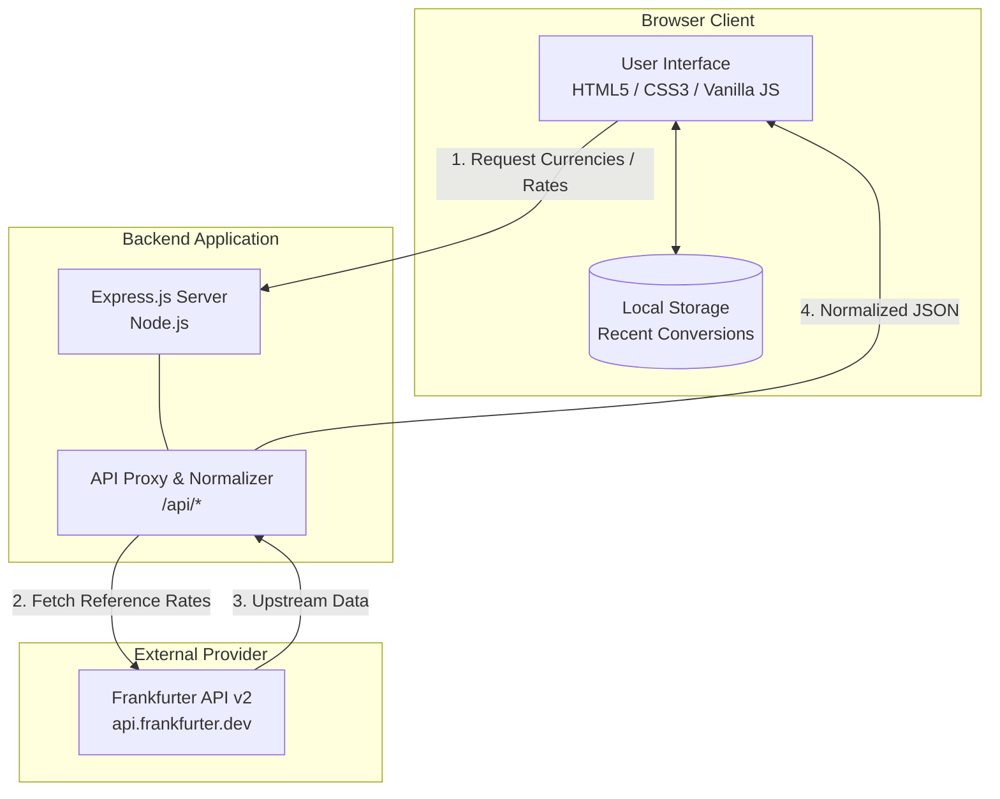

# Global Currency Explorer

> A fast, transparent currency conversion and global exchange rate explorer with animated 3D banknote visuals.


---

## Overview

Global Currency Explorer is a lightweight, zero-authentication web application designed for instant currency conversion and exchange rate analysis. It eliminates the friction of account registrations, paywalls, and clutter by connecting directly to published reference rates through an internal Express proxy backed by the public Frankfurter v2 API. The application is built for students, travelers, and online shoppers who need accurate, transparent exchange rate calculations alongside published rate dates. By combining a dark-themed editorial design with responsive 3D CSS banknote card animations, it offers an engaging and tactile conversion experience without external frontend frameworks.

---

## Key Features

- **Accurate Currency Conversion**: Converts amounts between supported world currencies using latest published reference exchange rates.
- **Interactive 3D Banknote Animation**: Dual-sided stylized CSS banknote card that dynamically updates denomination, currency code, and flag, executing a smooth 3D flip animation on conversion.
- **Searchable Currency Dropdowns**: Custom dropdown components allowing users to search and filter over 200 currencies by ISO code or country/currency name.
- **Instant Currency Swapping**: Dedicated swap control (`⇅`) to reverse source and target currencies instantly while maintaining UI state.
- **Quick-Select Amount Presets**: Fast amount buttons (`10`, `100`, `500`, `1000`) enabling instant recalculation without redundant network requests.
- **Global Exchange Rate Table**: Searchable reference rates table listing all quote currencies for any selected base currency.
- **Local Conversion History**: Client-side storage storing the 5 most recent conversions in browser `localStorage` without requiring user accounts or an external database.
- **Connection Health Monitoring**: Header status indicator tracking server connectivity against the `/api/health` endpoint.

---

## Demo / Screenshots

<!-- Demo / Screenshots Placeholder -->
<!-- Place your application screenshots inside docs/screenshots/ and uncomment below -->
<!--  -->
<!--  -->
<!--  -->

---

## Tech Stack

| Layer | Technology | Description |
| :--- | :--- | :--- |
| **Frontend Structure** | HTML5 | Semantic markup with accessible ARIA attributes |
| **Frontend Styling** | Vanilla CSS3 | Custom properties (design tokens), flexbox, grid, 3D CSS transforms & transitions |
| **Frontend Logic** | Vanilla JavaScript (ES6+) | Native DOM APIs, asynchronous Fetch API, state handling, and `localStorage` |
| **Backend Runtime** | Node.js (v18+) | JavaScript runtime executing the application server |
| **Backend Framework** | Express.js (v5.x) | HTTP server, static asset hosting, and API proxy routing |
| **External API** | Frankfurter API (v2) | Free, public exchange rate provider (`api.frankfurter.dev`) |
| **Deployment** | Vercel Serverless | Configuration configured via `vercel.json` |

---

## Architecture / How It Works

The application operates as a decoupled client-server architecture where Express serves both the static frontend bundle and provides internal REST proxy endpoints. The frontend communicates exclusively with local `/api/*` routes rather than querying third-party APIs directly. This design prevents CORS complications, normalizes data payloads, and centralizes error handling.



---

## Project Structure

```text
currency/
├── currency/                        # Application root folder
│   ├── markdown files/              # Product and architectural specifications
│   │   ├── 00-SOURCE-OF-TRUTH.md    # Master specification and requirements document
│   │   ├── 01-REFINED-PRODUCT-PLAN.md
│   │   ├── 02-ARCHITECTURE.md
│   │   ├── 03-FRONTEND-SPEC.md
│   │   ├── 04-BACKEND-SPEC.md
│   │   ├── 05-CURRENCY-DATA-API-SPEC.md
│   │   ├── 06-CURRENCY-NOTE-ANIMATION.md
│   │   ├── 07-USER-FLOWS.md
│   │   ├── 08-TESTING-ACCEPTANCE.md
│   │   ├── 09-IMPLEMENTATION-ROADMAP.md
│   │   ├── 10-IMPLEMENTATION-CHECKLIST.md
│   │   └── 11-README-SPEC.md
│   ├── public/                      # Static client assets
│   │   ├── app.js                   # Client-side state, events, animations, and API calls
│   │   ├── index.html               # Semantic HTML layout and UI components
│   │   └── style.css                # CSS variables, dark theme tokens, and 3D card styles
│   ├── .gitignore                   # Application-level git ignore rules
│   ├── package-lock.json            # Exact dependency tree lockfile
│   ├── package.json                 # Project metadata, scripts, and dependencies
│   ├── server.js                    # Express server and API proxy implementation
│   └── vercel.json                  # Serverless deployment configuration
├── .gitignore                       # Repository-level git ignore rules
└── README.md                        # Project documentation
```

---

## Getting Started

### Prerequisites

Ensure you have the following installed on your local machine:
- **Node.js**: `v18.0.0` or higher (verified on `v24.x`)
- **npm**: `v9.0.0` or higher

### Installation

1. Clone the repository:
   ```bash
   git clone <repository-url>
   ```

2. Navigate into the application directory:
   ```bash
   cd currency/currency
   ```

3. Install project dependencies:
   ```bash
   npm install
   ```

### Environment Variables

No external API keys or secret credentials are required. The server accepts an optional `PORT` variable:

| Variable | Required | Default | Description |
| :--- | :--- | :--- | :--- |
| `PORT` | No | `3000` | Port on which the Express server listens |

You can optionally set this in your shell or create a `.env` file (configured in `.gitignore`):

```env
PORT=3000
```

### Running the Application

Start the server using Node:

```bash
node server.js
```

### Verification

1. Open your web browser and navigate to:
   ```text
   http://localhost:3000
   ```
2. Alternatively, verify the backend health check in your terminal:
   ```bash
   curl http://localhost:3000/api/health
   ```
   Expected response:
   ```json
   {"status":"ok"}
   ```

---

## Usage

### 1. Converting Currencies
- Enter the desired amount in the **Amount** input field, or select one of the quick preset buttons (`10`, `100`, `500`, `1000`).
- Click the **From** dropdown and search for your source currency by code or country name (e.g., `USD`).
- Click the **To** dropdown and select the destination currency (e.g., `EUR`).
- Click **Convert**. The banknote element will execute a 3D flip animation, displaying the converted result, current exchange rate, and published rate date.

### 2. Swapping Currencies
- Click the swap button (`⇅`) between the currency dropdowns to invert the conversion pair instantly.

### 3. Exploring Global Exchange Rates
- Scroll to the **Global Rates** panel.
- Select a base currency using the base dropdown (defaults to `USD`).
- Use the **Search currency...** field to filter through the returned global rate catalog in real time.

### 4. Viewing Local History
- Each completed conversion automatically appends to the **Recent Conversions** list on the right.
- Conversions are persisted across sessions in `localStorage` (capped at the 5 most recent records).

---

## API Reference / Configuration

The Express backend exposes four REST endpoints:

| Endpoint | Method | Query Parameters | Description | Sample Response |
| :--- | :--- | :--- | :--- | :--- |
| `/api/health` | `GET` | None | Returns backend connectivity health status | `{"status": "ok"}` |
| `/api/currencies` | `GET` | None | Fetches normalized list of supported currencies | `{"currencies": [{"code": "USD", "name": "United States Dollar", ...}]}` |
| `/api/rate` | `GET` | `from` (string), `to` (string) | Fetches the exchange rate between two specific currencies | `{"base": "USD", "quote": "EUR", "rate": 0.88465, "date": "2026-10-02"}` |
| `/api/rates` | `GET` | `base` (string, optional, default: `USD`) | Fetches all quote rates relative to the specified base currency | `{"base": "USD", "date": "2026-10-02", "rates": {"EUR": 0.88, ...}}` |

---

## Testing

The project currently does not have an automated unit testing suite configured (`package.json` test script is unspecified). You can verify functional correctness through the following checks:

### 1. Backend Endpoint Validation
Test each API endpoint using `curl` or PowerShell `Invoke-RestMethod`:

```bash
# Verify server status
curl http://localhost:3000/api/health

# Verify currency catalog retrieval
curl http://localhost:3000/api/currencies

# Verify specific pair conversion rate
curl "http://localhost:3000/api/rate?from=USD&to=EUR"

# Verify global rates retrieval
curl "http://localhost:3000/api/rates?base=USD"
```

### 2. Manual UI Acceptance Checklist
- **Search Filtering**: Verify searching for `"India"` or `"INR"` finds the correct currency in all dropdowns.
- **Conversion Math**: Verify `100 USD` converts correctly according to the returned pair rate.
- **Animation**: Confirm the banknote card flips smoothly on conversion without layout shifts.
- **Persistence**: Refresh the browser page and ensure previous conversion records remain in the **Recent Conversions** panel.
- **Network Resilience**: Check that server disconnection or provider failure displays graceful error states in the UI.

---

## Roadmap

- [ ] **Automated Test Suite**: Implement unit and integration tests for API routes using Jest / Supertest and end-to-end tests using Playwright.
- [ ] **Historical Rate Visualizations**: Integrate a lightweight charting module to display historical exchange rate trends using Frankfurter historical time series.
- [ ] **Offline PWA Support**: Add a Service Worker with caching strategies to allow cached rate viewings when offline.
- [ ] **Export Capabilities**: Enable downloading recent conversion history in CSV or JSON format.

---

## Contributing, License, Contact

### Contributing
Contributions and suggestions are welcome. Please adhere to these guidelines:
1. Fork the repository and create a feature branch (`git checkout -b feature/new-feature`).
2. Commit your modifications with descriptive commit messages.
3. Push to your branch and open a Pull Request describing the changes.

### License
This project is licensed under the **ISC License** as specified in `package.json`.

### Contact
- **Author**: <your name>
- **Email**: <your email>
- **Project Repository**: <repository-url>
